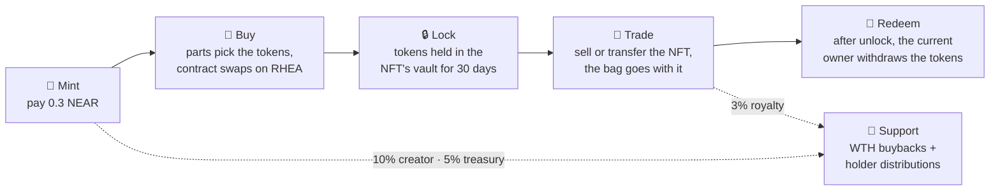
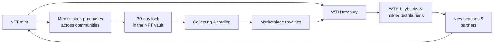
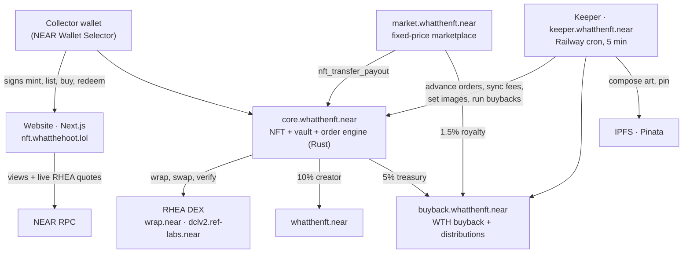

# WHAT THE NFT?!

### ONE OWL. TOO MANY MEMES.

**WHAT THE NFT?!** turns randomly mixed meme characters into collectible NFTs backed by real NEAR meme tokens. Each mint buys tokens across the participating meme communities and locks them for 30 days inside the NFT. The NFT stays tradable the whole time.

| 🦉 Collect | 💰 Real backing | 🤝 Cross-community |
|---|---|---|
| Every mint hatches a random mutant WTH owl wearing parts from different meme communities. | The parts decide which real meme tokens the contract buys. Those tokens sit in the NFT's own vault, redeemable by whoever holds it. | One mint creates buying activity across several meme tokens at once, plus revenue for the WTH ecosystem. |

**🌐 Website:** [nft.whatthehoot.lol](https://nft.whatthehoot.lol) · **🎬 Demo:** [watch on X](https://x.com/what_the_hoot/status/2121716402247909697) · **🧾 Mainnet evidence:** [docs/MAINNET_VERIFICATION.md](docs/MAINNET_VERIFICATION.md)

> **Live on NEAR mainnet.** Season 01 *MEME GENESIS*: 111 mutants at 0.3 NEAR, open now.

---

## Why it matters

Meme communities need more ways to generate economic activity than short bursts of trading. WHAT THE NFT?! gives collectors a fun reason to buy, hold and trade a basket of meme tokens together. Each mint routes value to several communities at once and to the WTH treasury.

### The problem

| | Problem | What we see |
|---|---|---|
| 1 | **Revenue beyond trading is thin** | Community treasuries and rewards usually depend on trading fees and volume. When activity cools, funding cools with it. |
| 2 | **Collaboration rarely moves tokens** | Meme communities collaborate culturally (art, memes, joint posts), but those collaborations seldom create measurable, ongoing token purchases. |
| 3 | **Most NFTs are just pictures** | Typical NFTs hold no redeemable on-chain assets and don't connect to the token economies around them. |
| 4 | **Attention is short-lived** | Meme-token markets move in sharp, short waves, with little that rewards sustained participation. |

Research behind problem 4:
- **68.67% of 18.68 million Pump.fun tokens** recorded their last bonding-curve trade on the day they were created. That covers launches from January 2024 to June 2026 ([CoinGecko, June 2026](https://www.coingecko.com/research/publications/average-lifespan-of-pumpfun-tokens)). This is Solana launchpad data and excludes trading after a token moves to an external DEX.
- **Total memecoin market capitalisation fell from a $150.6B peak (December 2024) to $47.2B (November 2025)**, about −69% ([CoinGecko, State of Memecoins 2025](https://www.coingecko.com/research/publications/state-of-memecoins-2025)).

These are market-wide figures, not NEAR measurements. Sources, methodology and limitations are in [docs/ECOSYSTEM_IMPACT.md](docs/ECOSYSTEM_IMPACT.md).

### Our solution

A collectible that **is** a basket of meme tokens.

Each mutant owl is assembled from character parts supplied by participating meme communities: a hat from one, a body from another, wings from a third. **Those parts decide which real tokens the contract buys** on RHEA and holds in that NFT's on-chain vault. The tokens are locked for 30 days, while the NFT itself can be transferred or sold at any time. Mint revenue and marketplace royalties also fund the creator and the WTH treasury, which buys WTH and distributes it to eligible holders.

### What makes it different

- **Real token backing.** Each NFT owns a measurable bag of meme tokens, verified on-chain at mint.
- **The art is the allocation.** Visual parts, chosen by on-chain randomness, determine the token basket.
- **Locked tokens, liquid NFT.** Tokens stay locked for 30 days; the NFT, and with it the right to the bag, trades freely.
- **Many communities per mint.** Every bag holds WTH (at least 20%) plus up to two partner tokens.
- **Redeemable and reloadable.** After unlock, the holder withdraws the tokens. An emptied NFT can be refilled while its season is open.
- **Built-in ecosystem revenue.** 10% creator and 5% WTH treasury on every mint, plus a 3% marketplace royalty.

---

## How it works



1. **Mint.** Pay NEAR to hatch a random mutant owl.
2. **Buy.** The contract buys the meme tokens chosen by the owl's body parts, on RHEA.
3. **Lock.** The tokens sit in the NFT's vault for 30 days.
4. **Trade.** The NFT, and its right to the tokens, can be sold or transferred at any time.
5. **Redeem.** After unlock, the current owner withdraws the tokens to their wallet.
6. **Support.** Mint fees and marketplace royalties flow to the creator and the WTH treasury.

---

## Why NEAR

Each capability below is something this product relies on directly:

| NEAR capability | What it does in WHAT THE NFT?! |
|---|---|
| **Named accounts + wallet-signed transactions** | Readable contract accounts (`core.whatthenft.near`); collectors mint, list and redeem from their own wallet through Wallet Selector. |
| **NFT standards (NEP-171/177/178/181/199)** | The collection is a standard NEAR NFT, so wallets and marketplaces can read ownership, metadata, approvals and royalties. |
| **On-chain randomness** | Traits are revealed from a *later* block's random seed, so nobody (team, keeper or minter) can pick the outcome. |
| **Asynchronous cross-contract calls** | The contract wraps NEAR, swaps on RHEA, then reads its own token balances in callbacks before it counts a purchase. |
| **RHEA DEX** | Real meme-token purchases through RHEA's DCL pools, with a minimum output taken from an on-chain quote in the same transaction chain. |
| **Smart-contract custody** | Tokens are held by the core contract and booked per NFT. Only the current owner can redeem, and only after the lock. |
| **Ownership carries the claim** | Ownership and the vault live in one contract, so transferring the NFT transfers the right to its tokens. |
| **Low, predictable fees** | Mainnet test transactions cost fractions of a cent: a redemption cost 0.0014 NEAR and a marketplace purchase 0.0009 NEAR. That makes a 0.3 NEAR collectible practical. |
| **Storage staking** | Each NFT's storage is paid by its own 0.009 NEAR storage fee, so the project doesn't subsidise holders. |

---

## Product features

| Feature | Status |
|---|---|
| Mutant generator: 12 meme communities, character-part system, original art | ✅ Live |
| Five cosmetic rarity tiers (60 / 25 / 10 / 4 / 1 %) | ✅ Live |
| Seasonal limited collections with rules frozen on-chain at open | ✅ Live (Season 01) |
| On-chain token-basket allocation (≥ 20% WTH + slot weights) | ✅ Live |
| Automated RHEA swaps with balance verification and token-fee handling | ✅ Live |
| Per-NFT vault accounting | ✅ Live |
| 30-day lock and redemption by the current owner | ✅ Live (redemption verified on mainnet) |
| Marketplace with royalty payout (3%: 1.5% creator, 1.5% treasury) | ✅ Live (sale verified on mainnet) |
| NFT artwork composition from original layers, pinned to IPFS, recorded on-chain | ✅ Live |
| Collection binder, NFT pages, live mint and order tracking | ✅ Live |
| Keeper automation: order completion, images, fee sync, buybacks | ✅ Live (every 5 minutes) |
| WTH buyback treasury and holder distributions | ✅ Deployed; the first round runs once the treasury reaches the $3 trigger |
| NFT reload (refill an emptied NFT) | ✅ In the contract, unit-tested; not yet exercised on mainnet |
| More seasons, partners, cross-chain tokens, fusion | 🗺️ Planned ([roadmap](docs/ROADMAP.md)) |

---

## Economics

The Season 01 configuration below is read from the deployed contract (on-chain season id 2):

| Parameter | Value |
|---|---|
| Supply | 111 NFTs |
| Base mint price | 0.3 NEAR (fixed) |
| Split of the base | **85%** meme tokens · **10%** creator · **5%** WTH treasury |
| Bag composition | WTH ≥ 20%, plus up to 2 partner tokens weighted by body part |
| Lock | 30 days from funding |
| Marketplace royalty | 3%, split 50/50 creator / treasury |
| Extra at mint | 0.009 NEAR storage fee + 0.03 NEAR refundable reserve |

**Example: one 0.3 NEAR mint**

| | NEAR |
|---|---|
| Wallet attaches | 0.339 (0.3 base + 0.009 storage + 0.03 refundable reserve) |
| Spent on meme tokens | 0.255 |
| Creator | 0.03 |
| WTH treasury | 0.015 |
| Reserve returned | Unused part. Up to 0.01 per step is paid to the keeper if it finishes the order. |

Tokens received are what the swap returns after RHEA's 1% pool fee and each token's own transfer fee (0–3%). Real example from mainnet mint #2: 0.204 NEAR bought **46,522 WTH** and 0.051 NEAR bought **4,598 THREE**.

**Scenario, not realised revenue:** if all 111 sell, about 28.3 NEAR buys meme tokens (at least 5.66 NEAR of it WTH), 3.33 NEAR goes to the creator and 1.67 NEAR to the WTH treasury. Secondary sales add 1.5% each to creator and treasury.

| Who | What they get |
|---|---|
| **Collectors** | A one-of-a-kind NFT holding real tokens they can trade with the NFT or redeem after the lock. |
| **Meme communities** | Real buying activity from every mint that uses their parts; purchased tokens stay in the vault for at least 30 days. |
| **WHAT THE HOOT?!** | Creator fees and royalties fund development; treasury income funds WTH buybacks and distributions to eligible holders. |

Full model, the treasury rules and the sustainability plan: [docs/ECONOMICS.md](docs/ECONOMICS.md). Token prices can fall to zero, and nothing here promises returns.

---

## Impact & sustainability



Every season repeats the cycle with new art and new partner communities. Revenue comes from four sources:
- mint fees;
- an ongoing royalty on secondary trading;
- treasury flows that return to the WTH community;
- partnerships that bring new communities in.

Locking and buying don't guarantee any price effect. What the model guarantees is real purchases, held tokens and transparent, on-chain flows. More: [docs/ECOSYSTEM_IMPACT.md](docs/ECOSYSTEM_IMPACT.md).

---

## Architecture



| Contract | Account | Purpose |
|---|---|---|
| Core | [`core.whatthenft.near`](https://nearblocks.io/address/core.whatthenft.near) | NFT, seasons, mint orders, swaps, per-NFT vault, redemption, reload |
| Marketplace | [`market.whatthenft.near`](https://nearblocks.io/address/market.whatthenft.near) | Fixed-price listings for this collection, royalty payouts |
| Buyback treasury | [`buyback.whatthenft.near`](https://nearblocks.io/address/buyback.whatthenft.near) | Buys WTH on RHEA, pays eligible holders in reconciled rounds |
| Keeper | [`keeper.whatthenft.near`](https://nearblocks.io/address/keeper.whatthenft.near) | Automation; can't move vault tokens |

Details, diagrams and the order lifecycle: [docs/ARCHITECTURE.md](docs/ARCHITECTURE.md). Complete reference: [docs/SYSTEM.md](docs/SYSTEM.md).

---

## Mainnet verification

The whole lifecycle has run on mainnet, with explorer links to every step:

| Step | Evidence |
|---|---|
| Contracts deployed | [core](https://nearblocks.io/txns/GoHqbyf3hhywe6UVUL3wBipEzSjVcj82M6CCgaFiH4jN) · [market](https://nearblocks.io/txns/CKJeeCm1V2CB7fgfPe9Pb3fEo4yKyjHgCsaAk9nu9boM) · [buyback](https://nearblocks.io/txns/8bFReHoRnfsqttjDub5ZgRFY7gqWmKKnFVzM4izVfdL3) |
| Real RHEA swap into an NFT vault | [WTH swap](https://nearblocks.io/txns/F1AeUsbRn32AQ9hYaK27UYKVrtXtGp4RsZHxyGnwZNRM) |
| Redemption of a full bag | [redeem](https://nearblocks.io/txns/EumTFVqnCfCt9qLgSME5hDmY748GGEBaVJ9BQ9DRFnsE) |
| Marketplace sale with royalty split | [buy](https://nearblocks.io/txns/5nRn92ixEpB7v32VSCYujkAxGyQV4JZXEQ5vV8bGfUtZ) |
| Season 01 opened | [open_season](https://nearblocks.io/txns/E8Tu2AsxFE55KrbyCuNULKGGTQH7riXftjdkgbVr7DgG) |
| Season 01 mint | [mint #2](https://nearblocks.io/txns/475pFhgQsqNQvMXNjEDzHei23JKiTrHEfUApo5ZMM62q) |
| Mint completed automatically by the keeper, artwork pinned to IPFS | [keeper finalize #3](https://nearblocks.io/txns/DacSN29aVxXWh8DxjigPrPAi8xLGJszafKLy7tberxpn) · [image](https://nearblocks.io/txns/3HtiVqnD4wdMKeTDGisfFQeyjPiHGQfB7fammznFiQUA) |

All transactions, amounts and reproducible check commands: [docs/MAINNET_VERIFICATION.md](docs/MAINNET_VERIFICATION.md).

---

## Roadmap

1. **More seasons:** new art, new partner crews, new supply.
2. **More meme-community partnerships** on NEAR.
3. **Cross-chain meme tokens** through NEAR cross-chain infrastructure *(planned)*.
4. **NFT fusion and cosmetic evolution** *(planned)*.
5. **Richer collecting:** binder achievements, marketplace offers and search *(planned)*.

Done so far and what's next: [docs/ROADMAP.md](docs/ROADMAP.md).

---

## Getting started

**Prerequisites:** Node.js 22+, pnpm 10 (`corepack enable`), Docker (for contract builds and tests).

```bash
git clone https://github.com/whatthehootwth-prog/whatthenft.git
cd whatthenft
pnpm install
cp apps/web/.env.example apps/web/.env.local   # set NEXT_PUBLIC_NETWORK / contract ids
pnpm dev                                       # http://localhost:3110
```

| Task | Command |
|---|---|
| TypeScript tests (domain, keeper) | `pnpm test` |
| Typecheck all packages | `pnpm typecheck` |
| Production web build | `pnpm --filter @wtn/web build` |
| Contract tests (Docker) | `docker build -t wtn-build -f contracts/Dockerfile.build contracts` then `docker run --rm -v "$PWD:/work" -w /work/contracts wtn-build cargo test --release` |
| Build contracts | see [contracts/CHECKSUMS.md](contracts/CHECKSUMS.md) |
| Keeper dry run against mainnet | `NETWORK=mainnet CORE_CONTRACT=core.whatthenft.near BUYBACK_CONTRACT=buyback.whatthenft.near pnpm --filter @wtn/keeper run-all` |
| Live read-only pool check | `pnpm feasibility` |

To run the site against the live contracts, set these in `apps/web/.env.local`:

```
NEXT_PUBLIC_NETWORK=mainnet
NEXT_PUBLIC_CORE_CONTRACT=core.whatthenft.near
NEXT_PUBLIC_MARKET_CONTRACT=market.whatthenft.near
NEXT_PUBLIC_RPC_URLS=https://rpc.mainnet.fastnear.com,https://free.rpc.fastnear.com,https://rpc.mainnet.near.org
```

Deployment templates: `deploy/railway/*.env.example`, [docs/DEPLOY_RAILWAY.md](docs/DEPLOY_RAILWAY.md) and [deploy/mainnet/README.md](deploy/mainnet/README.md).

**Repository:** `contracts/` (core, market, buyback · Rust) · `apps/web` (Next.js) · `apps/keeper` (automation) · `packages/domain` (economics, traits) · `packages/chain` (RPC, RHEA, registry, seasons) · `packages/assets` (art pipeline) · `deploy/` · `docs/` · `video/` (trailer).

---

## Security & risk

- **Reviews and tests:**
  - AI-assisted security review by Claude and ChatGPT; **no independent professional audit yet**;
  - 100 automated tests across contracts and TypeScript;
  - the full lifecycle tested on mainnet with small amounts.
- **Protections enforced in code:**
  - no NFT until every swap is verified;
  - no admin path that moves vault tokens;
  - season rules frozen at open;
  - only the current owner can redeem, after unlock.
- **Risks:**
  - meme tokens are volatile and can go to zero;
  - tokens are locked for 30 days;
  - some tokens charge their own transfer fees.
- **Not financial advice.**

Threat model: [docs/THREAT_MODEL.md](docs/THREAT_MODEL.md). Risks in plain language: [nft.whatthehoot.lol/risk](https://nft.whatthehoot.lol/risk).

---

## Links

| | |
|---|---|
| Website | https://nft.whatthehoot.lol |
| GitHub | https://github.com/whatthehootwth-prog/whatthenft |
| Demo video | https://x.com/what_the_hoot/status/2121716402247909697 |
| WHAT THE HOOT?! | https://whatthehoot.lol |

Built with Claude.
