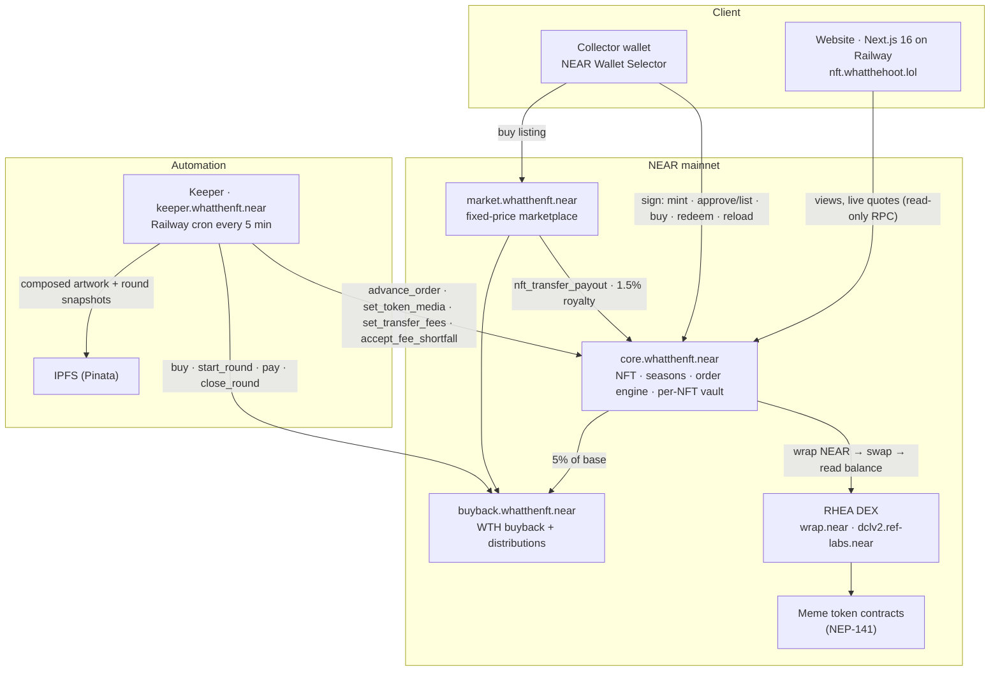
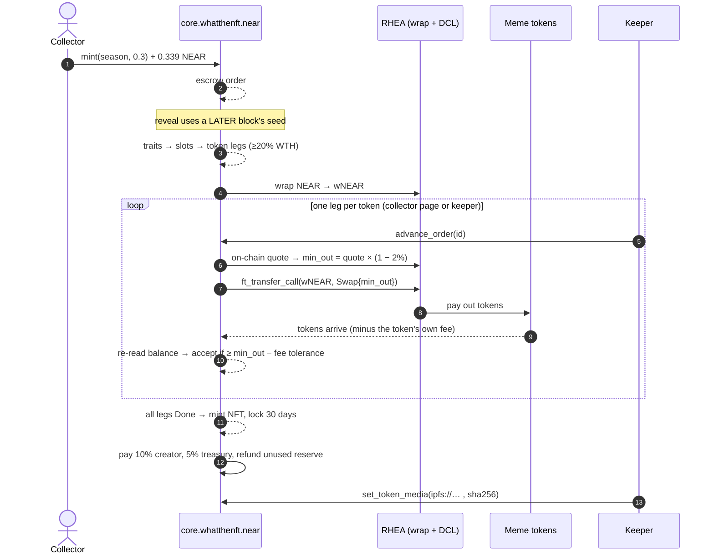

# Architecture

How WHAT THE NFT?! is built: the contracts, how a mint becomes a token-backed NFT, how ownership and redemption work, and what the automation does. For field-level detail (state, admin surface, every method) see [SYSTEM.md](SYSTEM.md).

---

## 1. System overview

**Design principles**
- **Value lives on-chain.** The website and keeper never hold user funds.
- **Verify, don't trust.** A purchase counts only after the contract re-reads its own token balance.
- **Permissionless progress.** Anyone can push a mint forward. The keeper does it automatically and is reimbursed a small capped fee.
- **Frozen rules.** A season's configuration is hashed and frozen when it opens.

## 2. Contracts

| Contract | Account | Responsibilities | Tests |
|---|---|---|---|
| **Core** (`contracts/core`) | `core.whatthenft.near` | NEP-171/177/178/181/199 NFT, seasons, randomness, mint orders, RHEA swaps, per-NFT vault, lock, redemption, reload, recovery, token-fee tolerance | 19 |
| **Marketplace** (`contracts/market`) | `market.whatthenft.near` | Fixed-price listings for this collection; royalty payout through `nft_transfer_payout`; stale-listing cleanup | 9 |
| **Buyback treasury** (`contracts/buyback`) | `buyback.whatthenft.near` | Swaps treasury NEAR for WTH on RHEA within on-chain limits; pays WTH holders in reconciled rounds | 14 |

All three are Rust (near-sdk 5.30), built reproducibly in Docker. The deployed hashes are in [`contracts/CHECKSUMS.md`](../contracts/CHECKSUMS.md).

## 3. A mint, step by step

**Order states:** `Escrowed → TraitsAssigned → SwapsPending → FullyBackedLocked`.

If a swap is rejected before anything is bought, the order refunds in full. If some legs bought and another can't complete, the order goes to `PartialExecutionRecovery`. There the payer chooses `retry_order` or `unwind_order` (sell what was bought back to NEAR and refund).

**No NFT is minted until every leg is verified.**

## 4. Randomness

Traits come from `env::random_seed()` of a block *after* the mint transaction (`WTN-TRAITS-v1`). They're derived deterministically from that seed and the order id. Neither the minter nor the keeper can know the seed when they submit, so nobody can choose an outcome. The same derivation is implemented in TypeScript and Rust and checked against shared test vectors (`test-vectors/`).

## 5. Vault, ownership and redemption

- **Per-NFT ledger.** The core contract holds all tokens but books each NFT's holdings separately (`token_info.holdings`). It also keeps a per-token `accounted` total, so `check_conservation` can compare the books against the real balance.
- **Ownership carries the claim.** The NFT and its vault live in the same contract. `redeem` checks the current owner directly, so whoever holds the NFT owns the bag.
- **Lock.** `redeem` is accepted only after `lock_until_ns`, which is 30 days after funding.
- **Redemption.** It sends each token to the owner as its own detached transfer, each with a callback. A failed transfer restores that token's claim. Redeeming revokes every marketplace approval, so an emptied NFT can't sell as if it were full.
- **Reload.** The owner of an emptied NFT can refill it in its open season. The same composition is bought again and a new lock applies.

## 6. Marketplace settlement

1. **List.** The owner calls core `nft_approve(token_id, market, {"price": …})`, attaching 0.01 NEAR for approval storage. Core notifies the market, which records the listing.
2. **Buy.** The buyer calls `market.buy(token_id)` with the price attached. The listing is removed first, so the NFT can't be sold twice. Core then runs `nft_transfer_payout`.
3. **Payout.** The seller receives 97%, the creator 1.5% and the treasury 1.5%. Any excess payment is refunded, and a failed transfer refunds the buyer.

## 7. Keeper automation

`apps/keeper` runs on Railway every 5 minutes (`run-all --send`). Each step is independent:

| Step | What it does |
|---|---|
| **fees** | Reads each season token's live transfer fee and updates core's tolerance if it changed; releases legs that froze only because of a fee |
| **orders** | Advances every in-progress mint until it's done; retries stuck refunds; reports orders that need a human |
| **media** | Composes each new NFT's image from the original art layers, in the website's exact layer order, pins it to IPFS and records it once on-chain with its sha256 |
| **buyback** | If the treasury is worth at least $3 (two agreeing price sources), buys WTH within the contract's limits, snapshots eligible holders, pays them and closes the round |

The keeper is a core operator: it can pause, manage seasons, set fee tolerances and set media. **It can't move vault tokens.** On the treasury it can only buy within caps and pay inside an open round.

## 8. Website

The website is a Next.js 16 app with React 19 and Tailwind 4, built in the project's comic design system.
- **Pages:** home, mint, marketplace, my collection (binder), NFT detail, WTH explainer, treasury, status, risk and terms.
- **Wallets:** NEAR Wallet Selector signs every transaction in the collector's own wallet.
- **Server routes:**
  - `/api/quote`: live RHEA quotes for the pre-mint preview and executable minimum;
  - `/api/status`: RPC, route and contract health;
  - `/api/nav`: vault valuation.
- **Resilience:** RPC failover across three public endpoints, with retries.

## 9. Repository map

| Path | Contents |
|---|---|
| `contracts/core`, `contracts/market`, `contracts/buyback` | Rust contracts + unit tests |
| `apps/web` | Website |
| `apps/keeper` | Automation, deploy-plan and token-fee tools |
| `packages/domain` | Shared economics, allocation, traits, order state machine |
| `packages/chain` | RPC client, verified token registry, RHEA quotes, season definitions |
| `packages/assets` | Art pipeline (organise layers, manifests, web copies) |
| `deploy/mainnet`, `deploy/railway` | Deployment arguments, commands, hosting config |
| `video/` | Trailer source (Remotion) |
